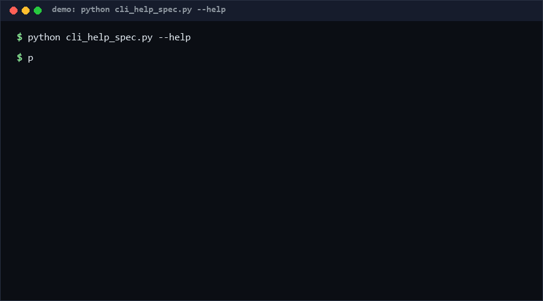

# cli-help-spec

Ten written conventions for CLI `--help` text — usage line, options
descriptions, examples, exit codes — plus a checker that lints help output
against them. Drop your help text in a file, run one command, get rule-id'd
findings with severities. Pure standard library, one file. *No direct
equivalent found as of 2026-10-13.*

<p align="center"></p>

## Problem

CLI help quality is inconsistent because "good help" is treated as taste
instead of spec. Reviewers re-litigate the same points (is there an example?
are exit codes documented? does every flag have a description?) on every PR.
A written, checkable convention turns that debate into a green/red gate.

## How it works

The spec defines rules H01–H10:

| Rule | Requirement |
|---|---|
| H01 | first non-empty line is `Usage: <prog> ...` |
| H02 | usage line has a `<placeholder>` or `(no arguments)` (warn) |
| H03 | an `Options:` section exists |
| H04 | every option has a description (same line after 2+ spaces, or next indented line) |
| H05 | an `Examples:` block with at least one indented example |
| H06 | exit codes documented (`Exit status` / `Exit codes`, case-insensitive) |
| H07 | `-h`/`--help` documented in Options |
| H08 | no trailing whitespace (warn, capped) |
| H09 | lines ≤ 100 chars (warn, capped) |
| H10 | program name appears in the first example (warn) |

`check` returns findings `{rule, severity, line, excerpt}`. Exit code is 1 on
errors, or on warnings with `--strict`.

## Quickstart

```console
$ mytool --help > help.txt
$ python cli_help_spec.py check help.txt
warn H08 line=3: trailing whitespace
0 error(s), 1 warn(s)
$ python cli_help_spec.py check help.txt --strict   # exit 1
```

A conformant 14-line help text checks in ~0.02s [Measured]; 500 synthetic
texts took 0.012s total (Performance).

## Why not X

No tool with the same scope surfaced during research (checked 2026-10-13),
but adjacent solutions exist:

- **clig.dev** — excellent *guidance*, deliberately not a machine-checkable
  lint; you still need a reviewer's eye.
- **argparse / clap / cobra help generators** — consistency *within* one
  framework, zero checking of the rendered output; hand-written sections
  (examples, exit codes) are exactly where they drift.
- **markdownlint / proselint** — lint prose, not help-text structure; they
  cannot see that a flag lacks a description.
- **docopt** — parses usage strings but does not grade the rest of the help
  document.

## Performance

All numbers [Measured] locally (Python 3.13, Windows 10, single core):

| Workload | Result | Command |
|---|---|---|
| 500 help texts (314 chars each) | 0.012s (40k texts/s) | `python cli_help_spec.py bench --files 500` |
| Single typical help text | ~0.02ms | `python cli_help_spec.py check help.txt` |

## Minimal Fallback

Keep this README's rule table as a PR checklist if you cannot run the tool.
You lose automation and the severity model, but the ten rules are the spec —
the checker is just enforcement.

## Design Trade-offs

- **Text-in, not process-out.** The checker reads help text from a file
  rather than invoking the CLI itself: no subprocess surprises, works for any
  language's output, and CI can lint captured help artifacts.
- **Errors vs warns split.** Structural gaps (no usage line, no examples)
  are errors; style issues (long lines, trailing spaces) are warns so
  `--strict` remains opt-in.
- **Capped whitespace/length findings.** One messy file should not bury the
  signal under 200 identical warns.
- **`Examples:`/`Options:` are literal headers.** Case variants are accepted
  for `Options:` but examples require the exact header — one canonical form
  keeps parsing trivial.

## Limits & Second-order Effects

- The checker cannot verify that examples *run*, only that they exist and
  name the right program.
- English-centric phrasings (`Usage:`, `Examples:`); localized help needs a
  per-locale rule table.
- Teams may over-fit to the linter and write help that is compliant but
  unreadable — the spec checks structure, not clarity.
- H10 can be satisfied by mentioning the program name in a comment-like
  example; it is a tripwire, not proof of correctness.

## FAQ

**When NOT to use this?** Do not use it for GUI/TPUI help, for generated
man pages (different conventions), or as a substitute for actually reading
the help text once before release.

**Why is H02 only a warning?** Genuinely argument-less tools exist; the rule
forces the `(no arguments)` note instead of banning empty usage.

**Can I add team rules?** Yes — fork the rule table; rule ids are stable so
CI annotations keep working.

**Does it handle colored help output?** Strip ANSI codes first; the checker
is plain-text only.

## [Core Assumptions]

1. Help text is captured to a file in CI or by hand; nothing calls the
   target CLI.
2. The ten rules encode one team's canonical style; other styles are valid
   but out of scope.
3. Findings are advisory input to review, not proof of help quality.

Confidence: high in the checker's parsing behavior (covered by self_test.py
across 61 cases); medium that H01–H10 are the *right* ten rules — the list
is deliberately small. As of 2026-10-13.

---

Part of the [zhengming-toolbox](https://github.com/chenhz01/zhengming-toolbox) — 105 purpose-built AI-engineering tools across neglected niches.

Related tools: [code-block-lang-check](https://github.com/chenhz01/code-block-lang-check) · [dependency-depth-budget](https://github.com/chenhz01/dependency-depth-budget) · [math-render-precheck](https://github.com/chenhz01/math-render-precheck)
